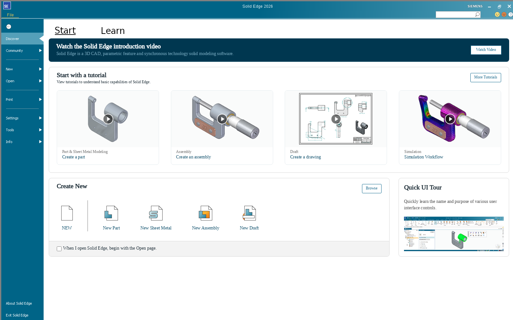
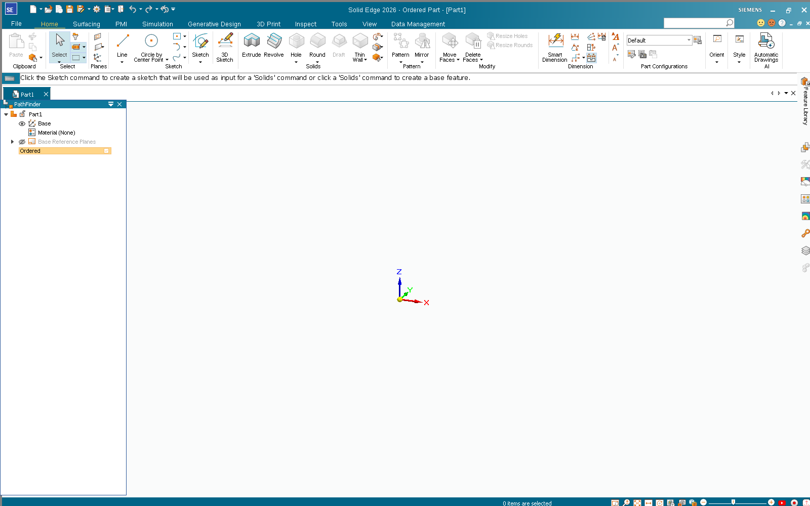

# Solid Edge 2026 Community Edition on Linux (Wine) – fixes

> **Deutsch, kurz:** Notizen, Skripte und Wine-Patches, mit denen Solid Edge 2026 Community Edition
> (Version 2510) unter Wine-Staging 11.21 läuft – inklusive WebView2-Startseite und der SVG-Icons im
> Menüband. Details unten auf Englisch.

This repository documents what was needed to get **Siemens Solid Edge 2026 Community Edition (2510)**
running under Wine, building on the basic instructions from
[cryinkfly/Solid-Edge-on-Linux](https://codeberg.org/cryinkfly/Solid-Edge-on-Linux).
Out of the box, Solid Edge starts, but:

1. it complains *"Install Microsoft Edge WebView2 Runtime and restart Solid Edge"* and the start page stays empty,
2. almost all icons (ribbon, PathFinder, side bar, status bar) are missing,
3. after the WebView2 start page was shown, the 3D view of a part stays covered by a stale image of the start page.

All three are fixed here. Two of them needed changes to Wine itself (patches included).

| Start page (WebView2) | Part with icons and 3D view |
|---|---|
|  |  |

> **Tested only in a headless container** (Xvfb + openbox, Mesa llvmpipe, no GPU), Ubuntu 24.04,
> WineHQ `winehq-staging` 11.21. The start page and creating a new part were verified.
> Actual modelling (sketch, extrude, save, …) was **not** tested.
> Feedback from real desktops is very welcome.

## What you need

- WineHQ **wine-staging 11.21** (`/opt/wine-staging`). Ubuntu's Wine 9.0 is too old: the WebView2
  runtime does not start under it at all.
- `winetricks`, `cabextract`
- The Solid Edge Community Edition download from Siemens (registration form on
  [resources.sw.siemens.com](https://resources.sw.siemens.com/en-US/download-solid-edge-community-edition)).
  The zip contains a Community license file (`LicenseFile/SELicense.lic`). Nothing from Siemens is
  included in this repository.

## Installation

```bash
export WINEPREFIX=$HOME/.wineprefixes/solidedge
winetricks -q win11 dotnet48 vcrun2022
winetricks -q win11     # dotnet48 switches the prefix to an older Windows version
```

`setup.exe` refuses to continue because its prerequisite check wants the Edge WebView2 installer.
Run the MSI directly instead (from the unpacked zip):

```bash
cd "Solid Edge"
wine msiexec /i "Siemens Solid Edge 2026.msi"
cp LicenseFile/SELicense.lic "$WINEPREFIX/drive_c/Program Files/Siemens/Solid Edge 2026/Preferences/"
```

Then apply the fixes and start Solid Edge:

```bash
./apply-fixes.sh      # registry settings, WebView2 runtime, patched Wine modules (uses sudo)
./run-solidedge.sh
```

When Wine asks to install **Wine Gecko**, that is fine (it is disabled for `Edge.exe` anyway, see below).

## The problems and the fixes

### 1. WebView2 runtime

- The official WebView2 installer (`MicrosoftEdgeWebView2RuntimeInstallerX64.exe /silent /install`)
  fails under Wine: the EdgeUpdate service exits with `0x80040902`.
- Instead, use the **Fixed Version runtime** (a `.cab` from Microsoft's CDN), unpack it into the
  prefix and point Solid Edge to it:
  - `WEBVIEW2_BROWSER_EXECUTABLE_FOLDER` (in `HKCU\Environment` and in `run-solidedge.sh`)
  - `HKLM\Software\WOW6432Node\Microsoft\EdgeUpdate\Clients\{F3017226-…}` → `pv` / `location`
    (Solid Edge checks this key before it creates a WebView).
- Solid Edge ignores the `WEBVIEW2_ADDITIONAL_BROWSER_ARGUMENTS` environment variable. The Chromium
  flags have to be set through the WebView2 policy instead:
  `HKCU|HKLM\Software\Policies\Microsoft\Edge\WebView2\AdditionalBrowserArguments`, value `Edge.exe`:

  ```
  --no-sandbox --disable-gpu --disable-gpu-compositing --disable-direct-composition
  --disable-d3d11 --disable-software-rasterizer --in-process-gpu
  ```

  Without `--in-process-gpu --disable-software-rasterizer` the start page stayed black in most runs.
  Without the composition flags, the hidden WebView kept covering other windows.

### 2. Missing icons → `d2d1`: `CreateSvgDocument` not implemented

Solid Edge's UI toolkit (Codejock ToolkitPro 24.1) draws its icons as SVG through
`ID2D1DeviceContext5::CreateSvgDocument` / `DrawSvgDocument`. In Wine these are stubs
(`fixme:d2d:d2d_device_context_CreateSvgDocument … stub!`), so every icon is blank.

[`patches/0001-d2d1-implement-svg-documents-with-nanosvg.patch`](patches/0001-d2d1-implement-svg-documents-with-nanosvg.patch)
adds a minimal `ID2D1SvgDocument`. It parses the stream with [nanosvg](https://github.com/memononen/nanosvg)
(`third_party/nanosvg`, zlib license; copy both headers to `dlls/d2d1/` before building). Drawing
rasterises the SVG at device resolution into a premultiplied BGRA bitmap, which is then drawn with
`DrawBitmap()`.

**Limits:** the DOM part of the interface (`GetRoot`, `FindElementById`, `CreatePaint`, …) is stubbed,
so anything that recolours icons through the SVG DOM (e.g. disabled states, dark theme) is ignored.
Text in SVGs is not supported by nanosvg.

### 3. Stale WebView image over the 3D view → `win32u`: cross-process visible region

The WebView2 browser process owns a child window inside Solid Edge's top-level window. When Solid
Edge hides the WebView (e.g. after opening a part), the browser process is never told that the
visible region of its window changed. Wine only re-checks the visible region of such windows in
`GetDCEx()` (see the comment *"cross-process invalidation is not supported yet"* in
`dlls/win32u/dce.c`). Chromium and wined3d keep their DCs around, so they keep drawing into Solid
Edge's X window with the old, non-empty visible region. Solid Edge only presents its 3D view on
demand, so the stale WebView frame wins.

How this was found:

- the 3D view's GL drawable contained the correct image;
- the view showed up immediately once the `msedgewebview2.exe` processes were killed;
- with `WINEDEBUG=+x11drv`, the WebView threads kept issuing `SET_DRAWABLE` to Solid Edge's top-level
  X window.

[`patches/0002-win32u-recheck-visrgn-for-cross-process-children.patch`](patches/0002-win32u-recheck-visrgn-for-cross-process-children.patch)
changes `update_dc()`: for DCs of windows whose top-level window belongs to **another process**, the
visible region is refreshed before drawing. The patch has a re-entrancy guard and skips the desktop
window, because a first version without them looped endlessly on `GetDC(0)` DCs. This costs one
server call per GDI operation on such DCs only.

### 4. Smaller things

- **Legacy IE start window:** Solid Edge also creates a legacy IE-based `SEStartupBrowseWindow`
  (Shell Embedding / Wine Gecko) that ends up over the 3D view. `mshtml` and `ieframe` are disabled
  for `Edge.exe` via `AppDefaults` (WebView2 does that job).
- **"Ordered / Synchronous" dialog:** a WebView-based popup shown when a part is created. It renders
  black under Wine (it is functional: Tab/Space/Enter work). It is suppressed with
  `PrefSets\Options-General\DoNotShowOrderedDefaultDialog` = `06 00… 01 00…`, so new parts start in
  Ordered mode.
- **License:** `SPLM_LICENSE_SERVER` points to the `SELicense.lic` shipped in the download.
- **Wine 11 + OpenGL:** `UseEGL=N` (`HKCU\Software\Wine\X11 Driver`) was used during testing. It was not
  needed in the end, but it is harmless.

## Binaries

`bin/d2d1.dll` (PE, x86_64) and `bin/win32u.so` (Unix side, x86_64) are built from Wine 11.21
sources plus the patches above. `win32u.so` also contains the wine-staging 11.21 patches that touch
win32u, plus the staging `dcomp` patch set (it changes the server protocol). Without them it does not
match the WineHQ staging build and crashes with `wine client error: write: Bad file descriptor`.

**They only fit WineHQ `winehq-staging` 11.21 on x86_64.** For any other Wine version, build from the
patches. `apply-fixes.sh` keeps the originals as `*.orig`, and a Wine update overwrites the patched
files. Checksums: `bin/SHA256SUMS`. Wine is LGPL-2.1+. The corresponding source changes are in
`patches/`.

## Files

| File | Purpose |
|---|---|
| `apply-fixes.sh` | WebView2 fixed runtime, registry settings, installs the patched modules |
| `run-solidedge.sh` | starts Solid Edge with the right environment |
| `patches/` | Wine source patches (against wine 11.21) |
| `bin/` | prebuilt patched modules for wine-staging 11.21 x86_64 |
| `third_party/nanosvg/` | nanosvg headers needed to build the d2d1 patch |

## Disclaimer

Solid Edge is a trademark of Siemens. This project is not affiliated with Siemens or Microsoft. You
need your own Solid Edge download and license (the Community Edition is free for personal,
non-commercial use).
